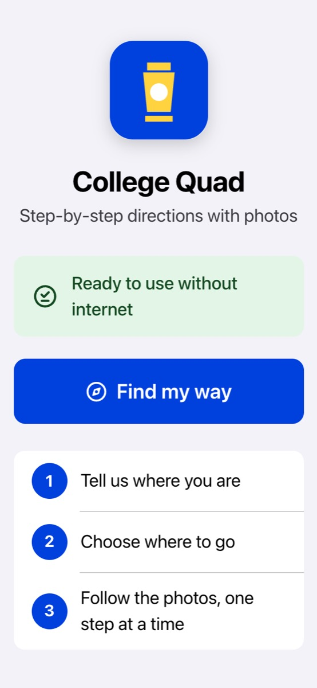
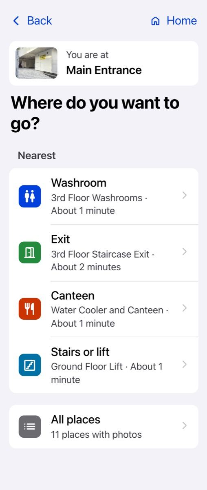
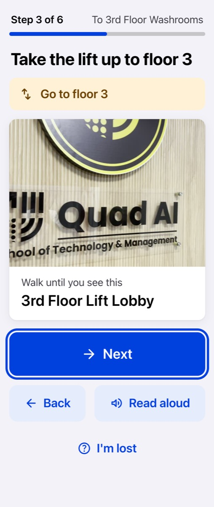
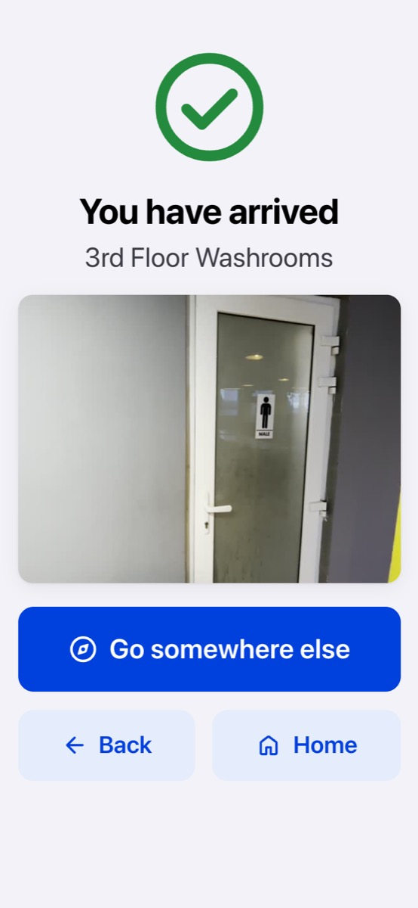
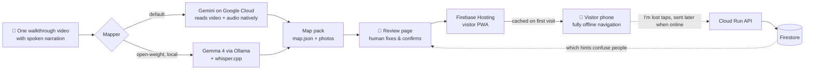

# 🏮 Lantern — One walk. Offline map.

**Walk through a building once with your phone camera, saying place names out loud. AI turns that video
into step-by-step photo directions that work with no internet, no GPS and no app install.**

Stadiums, railway stations, government hospitals, college campuses and the Kumbh Mela have no indoor maps.
Existing indoor-navigation products need floor plans, beacons or weeks of professional setup, so most places
in India and Asia will never get one. And in a crowd, mobile data dies.

Lantern makes a venue navigable in an afternoon, for visitors who are elderly, new to smartphones, or don't
read English well. *If my grandmother can't use it, it's not done.*

**▶ Live app:** https://lantern-53909.web.app · works in airplane mode after the first visit

| Home | Where to? | One step at a time | Arrived |
|---|---|---|---|
|  |  |  |  |

## How it works



1. **AI proposes.** One structured-output call turns the walkthrough video into a graph: places (name, type,
   floor, best photo frame, step-free, how to recognise it) and paths (steps, a hint for each walking direction
   with left and right properly swapped, stairs). Places visited twice ("back at the main corridor") are merged.
2. **A human confirms.** A local review page lists every place as a photo card. You rename, merge, delete,
   fix hints, then print A4 **QR "You are here" signs**.
3. **Visitors navigate offline.** The visitor app is a static PWA. Routes are plain shortest paths in JavaScript,
   with **no AI at runtime**, so directions are deterministic, instant, and work in airplane mode.
4. **Visitors correct.** "I'm lost" taps are queued on the phone and sent anonymously when it's back online.
   The review page highlights the paths where people get lost, so admins fix those hints first.

## Google technologies

| Service | What Lantern uses it for |
|---|---|
| **Gemini** (`gemini-flash-latest`, Files API, JSON-schema structured output) | Watches the walkthrough video **and** hears the narration in one call, and returns the venue graph. |
| **Gemma 4** (open-weight, via Ollama) | Same job fully on a laptop, so no video leaves the venue (`--provider gemma`). Gemini is the automatic fallback. |
| **Firebase Hosting** | Serves the visitor PWA worldwide over HTTPS (needed for camera + service worker). `/api/**` is rewritten to Cloud Run. |
| **Cloud Run** | `api/`: a tiny Flask service that receives anonymous feedback events and returns per-path summaries. |
| **Firestore** | Stores the feedback events (place ids, step and time only). Browser access is denied by rules; only the API writes. |

## Accessibility (non-negotiable)
- Base text 22px, instructions ~30px, every tap target ≥ 64px. Follows the phone's text-size setting; nothing scrolls sideways at 200%.
- **WCAG AAA contrast** (≥ 7:1) in light and dark mode. Colour is never the only signal.
- Every button has an icon **and** a word. Taps only: no swipes, long-presses, timers or auto-advance.
- Screen readers: semantic HTML, focus moves to each new screen, steps are announced (`aria-live`), photos are described.
- 🔊 **Read aloud** with on-device voices (works offline). Plain words: "Walk until you see this".

## Try it as a judge (no visit needed)
1. Open **https://lantern-53909.web.app** and wait for **"Ready to use without internet"**.
2. Turn on **airplane mode** (or DevTools → Network → Offline).
3. **Find my way → Choose from photos →** pick *Main Entrance* → **Washroom** → follow **Next** to *"You have arrived"*.
4. Or scan a QR sign: open `https://lantern-53909.web.app/#/venue/college_quad/here/main_entrance` directly.

## Run it yourself

```bash
brew install ffmpeg
python3 -m venv .venv && source .venv/bin/activate
pip install -r mapper/requirements.txt
echo 'GEMINI_API_KEY=your_key' > .env            # https://aistudio.google.com/apikey (never committed)

# 1. Film: walk slowly, pause 3 s facing each place, say "This is the Library", "Back at the main corridor".
# 2. Map it (Gemini):
python mapper/map.py videos/my_venue my_venue --name "My Venue"
# 3. Review, fix, print QR signs:
python mapper/review/server.py my_venue
# 4. Deploy everything (Firestore + Cloud Run + Hosting). First: gcloud auth login, firebase login
./deploy.sh
```

### Open-weight mode: Gemma, fully local
```bash
brew install ollama whisper-cpp && ollama serve &
ollama pull gemma4:12b
curl -L -o ~/.lantern/models/ggml-small.bin --create-dirs \
  https://huggingface.co/ggerganov/whisper.cpp/resolve/main/ggml-small.bin
python mapper/map.py videos/my_venue my_venue --provider gemma    # or MODEL_PROVIDER=gemma
```
Frames are sampled with ffmpeg, the narration is transcribed by whisper.cpp, and Gemma 4 builds the map with the
same JSON schema, all on the laptop. If Ollama isn't running or Gemma fails, the mapper falls back to Gemini.
Real output from our college walk (17 places, 16 paths in 104 s on an M4 Pro):
[`docs/examples/gemma4-college-quad.map.json`](docs/examples/gemma4-college-quad.map.json).

### Local preview
```bash
cd app && python3 -m http.server 8080      # http://localhost:8080 (service worker + camera work on localhost)
```

## Repo layout
| Path | What |
|---|---|
| `mapper/map.py` | CLI: videos → map pack (Gemini by default, `gemma.py` for open-weight) |
| `mapper/review/` | Local review page (stdlib server + one HTML file): fix places/paths, print QR signs, read feedback |
| `app/` | Visitor PWA: plain HTML/CSS/JS + service worker, no framework, no build step |
| `app/venues/<id>/` | Published map packs (`map.json` + `images/*.jpg`, ~40 KB per photo) |
| `api/` | Cloud Run feedback API (Flask + Firestore) |
| `deploy.sh` | One-command deploy of Firestore, Cloud Run and Hosting |

## Design principles
1. **Keep it simple:** fewest files and dependencies, no frontend build.
2. **AI proposes, human confirms:** nothing reaches visitors without review.
3. **Offline first:** after one visit, everything works in airplane mode.
4. **Accessible by default:** see above.

## Privacy
Videos are uploaded to Gemini only for mapping and deleted right after (or never leave the laptop with Gemma).
Feedback contains no personal data: just place ids, step number and time. Film door signs, never inside washrooms.

## Roadmap
Hindi + Bengali (Gemini translates names and hints at map time) · "Avoid stairs" routes (`has_stairs` is already
in the data) · "Where am I?" by camera using on-device image embeddings · self-serve web mapper on Cloud Run.

## License
MIT. See [LICENSE](LICENSE). Third-party credits in [NOTICE.md](NOTICE.md).
